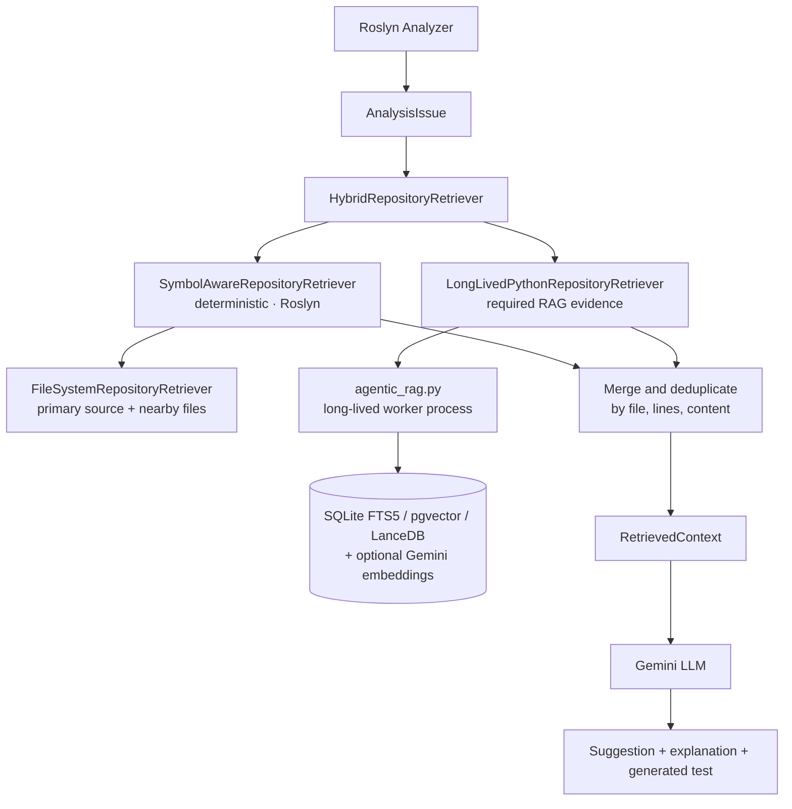

# Legacy Modernization Copilot

<p align="center">
  <a href="https://github.com/shreerachanaa1010-spec/legacy-modernization-copilot/actions/workflows/ci.yml"></a>
  
  
  
  
</p>

**A modernization workflow for legacy .NET code: Roslyn finds the problems, retrieval grounds the context, Gemini proposes the fix, and generated tests plus explicit human review decide whether it ships.**

**Live demo:** [Frontend](https://shreerachanaa1010-spec.github.io/legacy-modernization-copilot/) · [API](https://legacy-modernization-copilot-api.onrender.com/)
*The API runs on a free-tier host, so the first request after idle can take up to a minute.*

---

## Demo

<!--
HOW TO ADD YOUR DEMO VIDEO (pick one, then delete this comment):

Option A (best, plays inline on GitHub): edit this README in the GitHub web editor,
drag your .mp4 (under 100 MB) into the editor, and GitHub inserts a
https://github.com/user-attachments/assets/... link. Paste that link on its own line below.

Option B (YouTube/Loom): replace the line below with a clickable thumbnail:
[](https://youtu.be/YOUR_VIDEO_ID)

Option C (GIF): 
-->

> 🎥 Demo video coming soon.

**What the demo shows:** enter a `.csproj` path, run the pipeline, review the detected issue with its evidence, compare before/after code, inspect the generated test, then accept or reject.

---

## Problem

Modernizing legacy .NET code is slow and risky because teams must:

- find outdated patterns across a large codebase,
- understand the surrounding code before changing it,
- judge whether an AI-generated change is appropriate, and
- prove the original behavior still works afterwards.

This project turns those steps into a repeatable, evidence-based pipeline. **Core principle: AI generation proposes a change; verification decides whether it is safe.** A suggestion is never trusted just because a model produced it.

## Key features

- **Deterministic findings:** a Roslyn rule engine detects legacy patterns from real syntax trees (not regex or model guesses). It ships with six built-in rules and is designed for adding more.
- **Grounded suggestions:** every issue is enriched with repository evidence before the LLM is called.
- **Verification-first:** generated tests are built and run against the original and refactored code.
- **Human in the loop:** Accept, Reject and Reset decisions are persisted; accepting applies a guarded edit.
- **Safe public hosting:** the hosted version restricts access to approved project paths.

---

## Architecture

```mermaid
flowchart LR
  Developer[Developer] --> UI[React UI]
  UI --> API[ASP.NET Core API]
  API --> Analyze[1. Roslyn analysis]
  Analyze --> Retrieve[2. Repository evidence]
  Retrieve --> Suggest[3. Gemini suggestion]
  Suggest --> Test[4. Generate tests]
  Test --> Verify[5. Build and verify]
  Verify --> Result[Reviewable result]
```



| Layer | Responsibility |
|---|---|
| React + Vite | Project input, pipeline status, issue list, before/after diff, approve/reject review |
| ASP.NET Core | Orchestrates the pipeline and exposes REST endpoints |
| Roslyn Analyzer | Extensible rule engine that loads the .NET project and detects legacy patterns from syntax trees |
| Retrieval layer | Hybrid: Roslyn-derived symbol context plus Python lexical/vector enrichment |
| LLM layer | Generates structured modernization suggestions with Gemini |
| Test generator | Creates focused tests for each finding |
| Verifier | Builds and runs tests; the authority on whether a suggestion is safe |
| SQLite | Stores retrieval data, review decisions and accepted-refactoring history |

### Retrieval flow

Every finding passes through hybrid retrieval before anything is sent to the LLM. If the Python RAG worker is unavailable or returns no usable evidence, generation reports an error rather than continuing with Roslyn-only context.



- The Python worker indexes repository content in SQLite FTS5 with BM25-style lexical ranking, and supports embedding-based retrieval when a provider is configured.
- The .NET retriever adds the containing class/method symbol and related evidence from Roslyn.
- Results are merged and deduplicated by file path, line range and content.
- The worker keeps running across requests and returns evidence only; there is no filesystem-only fallback.
- Indexing skips unchanged chunks and prunes `bin`, `obj`, `node_modules`, `.venv` and `dist`.

### End-to-end flow

1. The user selects a project (or the sample project) in the UI.
2. The API resolves and validates the allowed project path.
3. The analyzer identifies modernization issues.
4. The retriever pulls repository context and symbol evidence.
5. Gemini proposes a refactor with an explanation.
6. The generator creates a test for each finding.
7. If a test project is supplied, the verifier builds and tests the original and refactored versions.
8. The review UI shows evidence, before/after code and test; the user accepts or rejects.

---

## Modernization rules

The analyzer ships with around 20 built-in deterministic rules, each covered by unit tests in `backend/src/LegacyModernization.Analyzer.Tests/`. New rules plug into `PatternRuleEngine` without changes to the rest of the pipeline.

| Rule | Name | Detects |
|---|---|---|
| `LMC001` | SyncOverAsyncRule | Blocking on async code (`.Result`, `.Wait()`, `GetAwaiter().GetResult()`) |
| `LMC002` | WebClientRule | Legacy `WebClient` instead of `HttpClient` |
| `LMC003` | ConfigureAwaitRule | Awaited calls missing `ConfigureAwait(false)` in library code |
| `LMC004` | DisposePatternRule | `IDisposable` resources not wrapped in `using` |
| `LMC005` | HttpClientInstantiationRule | Direct `new HttpClient()` instead of `IHttpClientFactory` |
| `LMC006` | DateTimeNowRule | `DateTime.Now` instead of `DateTime.UtcNow` |
| `LMC007` | ThreadSleepRule | Blocking `Thread.Sleep()` calls in async code |
| `LMC008` | StringCaseRule | Culture-sensitive `ToLower()` / `ToUpper()` usage |
| `LMC009` | StringComparisonRule | String comparisons missing an explicit `StringComparison` |
| `LMC010` | AsyncVoidMethodRule | `async void` methods |
| `LMC011` | DateTimeParseRule | Culture-sensitive date parsing |
| `LMC012` | NewRandomRule | Repeated `new Random()` creation |
| `LMC013` | TaskRunRule | Overuse of `Task.Run` / `Task.Factory.StartNew` |
| `LMC014` | LockThisRule | Locking on `this` or type objects |
| `LMC015` | CancellationTokenRule | Async APIs without `CancellationToken` |
| `LMC016` | StringLiteralComparisonRule | String literal equality checks that should use safer helpers |

---

## Design decisions and trade-offs

| Decision | Alternatives considered | Why this one |
|---|---|---|
| Roslyn AST analysis | Regex heuristics, pure LLM review | Deterministic, explainable findings tied to real syntax and symbols |
| Retrieval-grounded suggestions | Prompt-only answers, raw code dumps | Better evidence quality and lower hallucination risk |
| Fail-loud retrieval | Empty-context generation, silent fallback | Avoids false confidence when repo evidence is missing |
| Verification as the safety authority | Trusting model confidence | Only test results can establish that a suggestion is safe |
| Exact-match source edits behind review | Auto-applying patches | A safety boundary before any code is modified |
| Local-first verification, restricted hosted demo | Fully remote pipeline, unrestricted hosting | Transparent and cheap to run locally; safe to expose publicly |

---

## Results

Analyzer run against [WebAPIContrib](https://github.com/WebApiContrib/WebAPIContrib), an open-source ASP.NET Web API library, with no rule changes made for it.

- **Project analyzed:** `samples/WebAPIContrib/src/WebApiContrib/WebApiContrib.csproj`
- **Raw output:** [`reports/WebApiContribResults.txt`](reports/WebApiContribResults.txt) · [`docs/results.md`](docs/results.md)

| Rule | Pattern | Findings |
|---|---|---:|
| `LMC001` | Sync-over-async | 5 |
| `LMC002` | `WebClient` usage | 3 |
| `LMC003` | Missing `ConfigureAwait(false)` | 7 |
| `LMC004` | Undisposed `IDisposable` | 0 |
| `LMC007` | Blocking thread sleeps | 1 |
| `LMC008` | Culture-sensitive casing | 1 |
Single-repository run, not a benchmark. See [Limitations](#limitations-and-roadmap).

---

## Tech stack

- **Backend:** .NET 10, ASP.NET Core, Roslyn, SQLite / FTS5, rate limiting and path validation
- **Frontend:** React 19, TypeScript, Vite, Tailwind CSS
- **AI and retrieval:** Gemini API, Python 3.11 retrieval worker, SQLite FTS5 (optional pgvector / LanceDB, optional Gemini embeddings)
- **Infrastructure:** Render (API), GitHub Pages (frontend), GitHub Actions (CI/CD), Docker

---

## Getting started

### Prerequisites

.NET 10 SDK, Node.js 22+, Python 3.11+, Git. Docker is optional.

### 1. Clone and configure

```bash
git clone https://github.com/shreerachanaa1010-spec/legacy-modernization-copilot.git
cd legacy-modernization-copilot
cp .env.example .env          # PowerShell: Copy-Item .env.example .env
```

Set your key in `.env`:

```env
GEMINI_API_KEY=your_key_here
GEMINI_MODEL=gemini-3.5-flash-lite
```

### 2. Install Python retrieval dependencies

```bash
python -m pip install -r python/requirements.txt
```

Python retrieval is **required** for suggestions and generated tests. Without it, Roslyn analysis still runs, but generation returns an error instead of silently using Roslyn-only context. Without a Gemini key, suggestions and tests cannot be generated.

### 3. Run the backend

```bash
dotnet restore
dotnet run --project backend/src/LegacyModernization.Api/LegacyModernization.Api.csproj --launch-profile http
```

The API runs at `http://localhost:5198` (interactive docs via Scalar).

### 4. Run the frontend

```bash
cd frontend
npm install
npm run dev
```

Open `http://localhost:5173` and enter:

```
samples/LegacySampleProject/LegacySampleProject.csproj
```

To enable verification, also provide the test project:

```
samples/LegacySampleProject.Tests/LegacySampleProject.Tests.csproj
```

### Docker

Unified image (UI + API on port `7860`):

```bash
docker build -t legacy-modernization-copilot .
docker run --rm -p 7860:7860 -e GEMINI_API_KEY=your_key legacy-modernization-copilot
```

Pass `GEMINI_API_KEY` at runtime; never bake it into the image. For local development, Compose starts separate containers (frontend `5173`, backend `5198`):

```bash
docker compose up --build
```

**Hugging Face Space:** create a Docker Space and add `GEMINI_API_KEY` as a Space secret. For automatic deployment, add an `HF_TOKEN` repository secret (write access to the Space) and an `HF_SPACE_REPO` repository variable (`owner/space-name`). The workflow force-syncs the Space's `main` branch from this repository's `main`, so do not edit source in the Space repo.

---

## Configuration

Read from the environment or the local `.env` file at startup.

| Variable | Default | Purpose |
|---|---|---|
| `GEMINI_API_KEY` | required for full workflow | Enables Gemini suggestions and generated tests |
| `GEMINI_MODEL` | `gemini-3.5-flash-lite` | Gemini model for suggestions and test generation |
| `GEMINI_TIMEOUT_SECONDS` | `60` (clamped 5-300) | Timeout for Gemini API calls |
| `TEST_RUN_TIMEOUT_SECONDS` | `120` (clamped 10-600) | Max duration of each `dotnet test` verification run |
| `RAG_STORE_MODE` | `sqlite` | `sqlite`, `pgvector`, `lancedb`, or `allow-fallback` |
| `RAG_SQLITE_PATH` | `./.legacy_rag.sqlite3` | SQLite database location |
| `RAG_LANCEDB_PATH` | `./.lancedb` | LanceDB location (when `RAG_STORE_MODE=lancedb`) |
| `RAG_EMBEDDING_PROVIDER` | `none` | Keeps the default path lexical and local |
| `RAG_EMBEDDING_MODEL` | `gemini-embedding-001` | Embedding model metadata |
| `RAG_EMBEDDING_DIM` | `768` | Embedding vector dimension |
| `RAG_INDEX_VERSION` | `1` | Retrieval index compatibility version |
| `PYTHON` | `python` | Python executable for the retrieval worker |
| `RAG_PYTHON_TIMEOUT_SECONDS` | `5` | Per-query timeout for the retrieval worker |
| `RAG_PYTHON_MAX_OUTPUT_BYTES` | `1048576` | Max response size accepted from the worker |

---

## API surface

| Endpoint | Purpose |
|---|---|
| `POST /api/analysis` | Analyze a project with Roslyn |
| `POST /api/suggestions` | Retrieve evidence and generate suggestions |
| `POST /api/testgeneration` | Generate tests for findings |
| `POST /api/verification` | Verify a test project |
| `POST /api/pipeline` | Run the complete workflow |
| `POST /api/review` | Persist an `approved`, `rejected` or `pending` decision; approval applies the suggested edit |

Example pipeline request:

```json
{
  "projectPath": "samples/LegacySampleProject/LegacySampleProject.csproj",
  "testProjectPath": "samples/LegacySampleProject.Tests/LegacySampleProject.Tests.csproj"
}
```

### Review decisions

- **Accept & Apply** replaces the issue's original snippet. The file must be inside the analyzed project, the snippet must match exactly once, and the replacement must not increase C# syntax errors. Stale, ambiguous, empty or invalid edits are refused.
- **Reject** records the decision and does not modify code.
- **Reset** returns a rejected decision to pending. After acceptance, it restores the original only if the applied replacement is still present exactly once.

Acceptance is a user decision, not proof of safety, and it does not run tests automatically. Supply a test project path to the pipeline and review the verification result separately.

---

## Testing and CI/CD

```bash
dotnet test backend/src/LegacyModernization.Analyzer.Tests/LegacyModernization.Analyzer.Tests.csproj
dotnet test backend/tests/LegacyModernization.Rag.Tests/LegacyModernization.Rag.Tests.csproj
dotnet test backend/tests/LegacyModernization.Api.Tests/LegacyModernization.Api.Tests.csproj
python -m pytest python/tests -q
cd frontend && npm run build
```

Retrieval evaluation:

```bash
python python/evaluate_rag.py --repo-root samples/LegacySampleProject --dataset python/tests/fixtures/retrieval-golden.jsonl --output reports/rag-eval-report.json
```

**GitHub Actions** runs the three .NET test projects, the Python tests and the frontend build, and also handles frontend deployment to GitHub Pages and optional hosted deployment.

---

## Project structure

```text
backend/src/
  LegacyModernization.Analyzer/        Roslyn analysis and modernization rules
  LegacyModernization.Analyzer.Tests/  Unit tests for the modernization rules
  LegacyModernization.Api/             ASP.NET Core API and pipeline orchestration
  LegacyModernization.Core/            Shared models and contracts
  LegacyModernization.LLM/             Structured Gemini integration
  LegacyModernization.Rag/             Retrieval, SQLite, FTS5, indexing
  LegacyModernization.TestGenerator/   Generated test creation
  LegacyModernization.Verifier/        Build, test and behavior verification
backend/tests/
  LegacyModernization.Rag.Tests/       Retrieval, indexing and store tests
  LegacyModernization.Api.Tests/       Accept/reject/reset and guarded-edit tests
tools/AnalyzerHost/                    Console host that runs analysis and writes reports/
frontend/                              React + Vite review interface
python/                                Retrieval worker and evaluation tools
samples/                               Legacy and refactored reference projects
generated-tests/                       Output location for generated test files
reports/                               Analysis and evaluation output
docs/                                  RAG implementation plan and results
.github/workflows/                     CI and deployment
```

---

## Production considerations

This project is scoped for secure, reviewed execution, not unrestricted production use.

- **Data egress:** source code and repository context are sent to the Gemini API. A production deployment would need explicit consent, redaction rules and logging controls. The user must be authorized to submit the code under analysis.
- **File-write guardrails:** edits apply only to exact, single-location matches, with syntax validation before acceptance. Stale, empty, ambiguous or unsafe writes are refused.
- **Timeouts and caps:** Gemini calls, test runs and retrieval-worker queries are time-bounded, and worker output size is capped.
- **Multi-user and CI:** production use would need authentication, per-user workspace isolation, separate review-state storage, managed secrets and artifact retention. Free hosting suits a portfolio demo, not a shared modernization platform.

---

## Limitations and roadmap

**Known limitations**

- LLM suggestions are probabilistic and can hallucinate details even with repository context.
- Verification bounds risk but does not prove semantic equivalence for every refactor.
- First-time indexing or embedding can be slow on large repositories.
- Accept does not auto-run tests; the user must verify applied changes.
- The hosted demo intentionally restricts project scope.
- Results come from a single real repository and are not a benchmark.

**Roadmap**

- Expand the rule library with additional patterns on the existing rule engine.
- Publish a stable retrieval benchmark with metric history from `evaluate_rag.py`.
- Report suggestion precision and verification pass rates on real repositories.
- Add stronger CI gating for analyzer, RAG and API regressions.
- Add authentication, tenancy boundaries, auditability and observability.

---

## License

MIT. See [LICENSE](LICENSE).


Built by [Rachanaa Shree](https://github.com/shreerachanaa1010-spec) · [LinkedIn](https://www.linkedin.com/in/YOUR-HANDLE)
